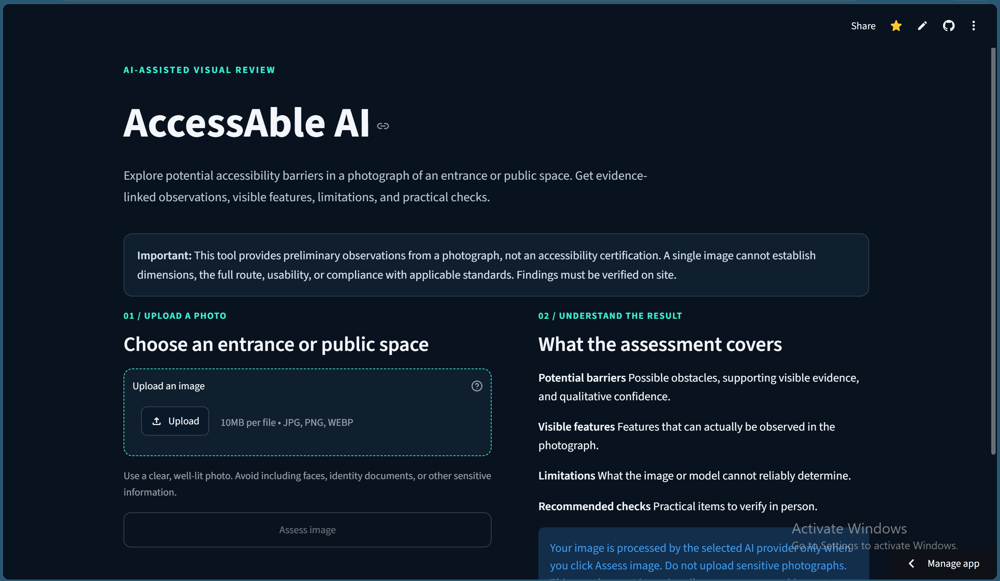
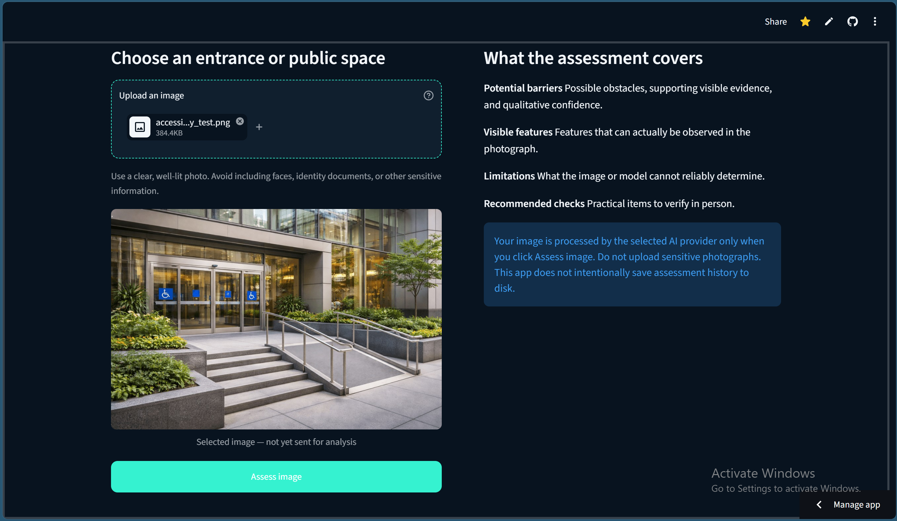
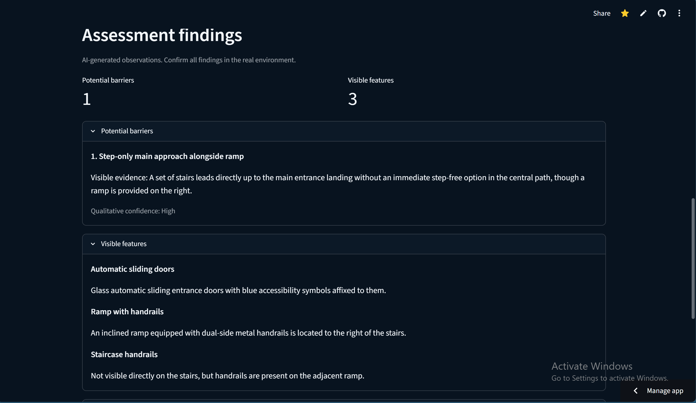
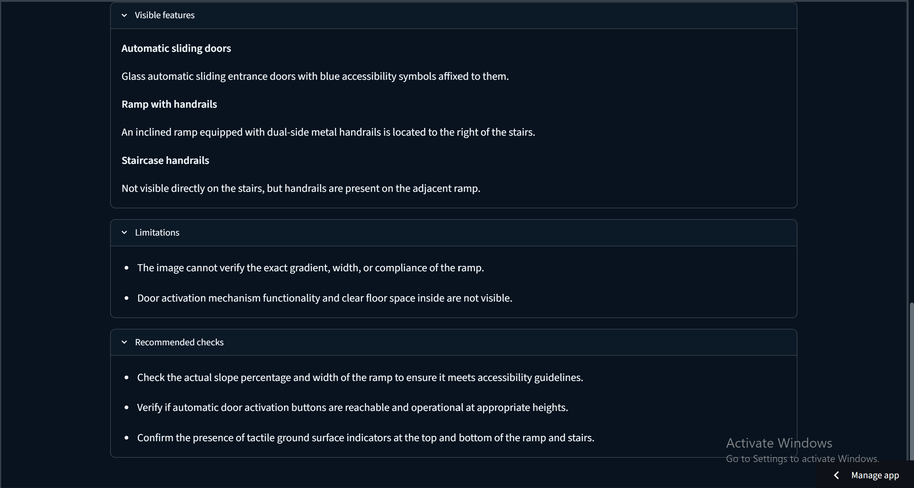

# AccessAble AI

**🚀 [Try the Live Demo](https://accessable-ai.streamlit.app/)**

Explore a preliminary AI-assisted visual accessibility assessment of an entrance or public space. Findings are suggestions, not accessibility certification, and must be verified on site.

**AI-Powered Visual Accessibility Assessment**

AccessAble AI is a browser-based application that uses a vision-capable AI model to help users examine photographs of entrances and public spaces for potential accessibility barriers.

Upload an image, review the visible evidence identified by the model, understand the limitations of the image-based assessment, and consider recommended checks that may require an on-site inspection.

> **Important:** AccessAble AI provides preliminary visual assistance only. It does not certify accessibility, determine legal compliance, replace professional assessment, or establish that a location is accessible based on the absence of detected barriers.

## Application Screenshots

### Application Overview



### Image Assessment



### Accessibility Findings



### Recommended Checks



## Features

- **Image upload and validation:** Accepts JPEG, PNG, and WebP images.
- **Image safety checks:** Validates image content, dimensions, file size, and supported formats before analysis.
- **Potential barriers:** Presents possible accessibility concerns alongside visible evidence and qualitative confidence levels.
- **Visible features:** Separately identifies relevant features observed in the image.
- **Assessment limitations:** Explains what cannot reliably be determined from the photograph.
- **Recommended checks:** Suggests further observations or on-site checks.
- **Structured response validation:** Validates the AI response before presenting the assessment.
- **Privacy-conscious design:** Does not provide permanent assessment history.
- **Automated tests:** Includes tests for image validation, response validation, the assessment service, and application behavior.

## Technology stack

- Python 3.12
- Streamlit
- Google Gen AI Python SDK
- Pillow
- pytest

Dependency versions are pinned in `requirements.txt` and `requirements-dev.txt`.

## Requirements

- Windows with PowerShell, or another environment capable of running Python and Streamlit.
- Python 3.12 for the documented Windows setup.
- Internet connectivity for an actual Gemini assessment.
- A Gemini API key for live image analysis.

The configured model is `gemini-3.5-flash-lite`. Its availability and live inference behavior have not been verified as part of the local automated test suite.

## Setup on Windows PowerShell

### 1. Open the project directory

If you already have the repository locally:

```powershell
Set-Location "C:\Users\Administrator\Documents\AccessAble-AI"
```

For a fresh checkout, first clone the repository from its hosting location and change into the resulting project directory.

### 2. Verify Python

```powershell
py -3.12 --version
```

Confirm that Python 3.12 is available.

### 3. Create a virtual environment

Run this only if the project does not already have a `.venv` directory:

```powershell
py -3.12 -m venv .venv
```

### 4. Install dependencies

Use the virtual environment's Python executable:

```powershell
.\.venv\Scripts\python.exe -m pip install --upgrade pip
.\.venv\Scripts\python.exe -m pip install -r requirements-dev.txt
```

The development requirements include the application dependencies and pytest.

### 5. Configure the Gemini API key

Obtain an API key through [Google AI Studio](https://aistudio.google.com/app/apikey), subject to Google's current access and usage terms.

Set the key in the current PowerShell session:

```powershell
$env:GEMINI_API_KEY = "YOUR_GEMINI_API_KEY"
```

Replace the placeholder with your actual key. Do not include quotation marks as part of the key itself.

This environment variable is session-scoped. A new PowerShell session will need the variable set again.

**Security precautions:**

- Never commit an API key to Git.
- Do not place real credentials in `README.md`, screenshots, source files, or shared logs.
- Do not upload sensitive or identifiable photographs unless you are authorized to share them with the third-party AI service.
- When an assessment is explicitly submitted, the image is sent to Google's Gemini service for processing.

### 6. Run the application

```powershell
.\.venv\Scripts\python.exe -m streamlit run app.py
```

Streamlit will display a local address in the terminal, normally `http://localhost:8501`.

Open the displayed local address in your browser.

The app can display its interface without a Gemini API key, but a live assessment requires a valid key and an available configured model.

**Do not click the assessment button during a no-live-request verification session.** Submitting an assessment can make a real external API request.

## Run automated tests

From the project root:

```powershell
.\.venv\Scripts\python.exe -m pytest -q
```

The automated tests use controlled test inputs and mocked dependencies where appropriate. They are intended to verify local behavior without requiring a live Gemini request.

The established project checkpoint passed **56 tests**. Run the suite again after setup to verify the current environment.

To compile-check the application and tests:

```powershell
.\.venv\Scripts\python.exe -m compileall -q app.py src tests
```

## Project structure

```text
AccessAble-AI/
├── .streamlit/
│   └── config.toml
├── src/
│   └── accessable_ai/
│       ├── __init__.py
│       ├── assessment_service.py
│       ├── config.py
│       ├── gemini_client.py
│       ├── image_validation.py
│       ├── response_schema.py
│       └── response_validation.py
├── tests/
│   ├── test_app.py
│   ├── test_assessment_service.py
│   ├── test_gemini_client.py
│   ├── test_image_validation.py
│   ├── test_response_schema.py
│   └── test_response_validation.py
├── app.py
├── requirements.txt
├── requirements-dev.txt
├── .gitignore
└── README.md
```

## Responsible use and limitations

- An image cannot reliably establish every accessibility condition, measurement, route gradient, clearance, or legal requirement.
- Lighting, camera angle, occlusion, image quality, and missing context may affect the analysis.
- Qualitative confidence is not a calibrated probability or a certification.
- A feature not detected by the model should not be assumed absent from the real location.
- Treat generated findings as suggestions that require independent verification.
- Use an appropriate on-site inspection or qualified accessibility professional when decisions require reliable measurements or compliance determinations.

## Privacy and API usage

Image analysis involves sending the selected image to Google's Gemini service. Review the applicable provider privacy terms and your organization's data-handling requirements before using real-world images.

The project does not provide permanent assessment history. Avoid submitting confidential, sensitive, or personally identifiable imagery unless you have appropriate authorization.

Gemini usage is subject to the provider's current availability, quotas, and terms. This project does not guarantee free-tier availability or a particular model's continued availability.

## Development Status

- The initial local Git checkpoint is `be16a56` (`Build AccessAble AI visual accessibility review app`).
- The local automated test suite passed 56 tests at that checkpoint.
- The deployed Streamlit application has successfully completed an end-to-end image assessment using the configured Gemini model.
- Assessment results are preliminary visual observations, not accessibility certification. Findings should be verified through appropriate on-site measurements and checks.

## License

No open-source license has been added yet. Unless a license is explicitly added, do not assume that this repository grants permission to reuse, distribute, or modify the project.
